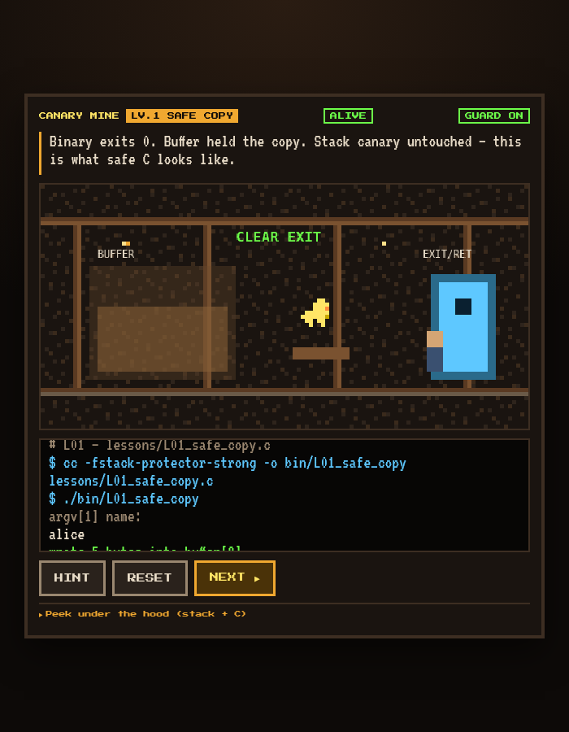

# Learn: CANARY MINE

<p align="center">
  
</p>

A companion course to [libcanary](../README.md): an 8-bit browser game plus 12
real C programs that teach how stack canaries work and how everyday C mistakes
break memory safety.

**Play it online: <https://noamadept.github.io/libCanary/>**

The game uses a coal-mine metaphor. Toxic gas is the overflow, the yellow bird
is the canary, and the exit door is the return address. Four views stay in sync:

| Panel | Role |
|-------|------|
| **Coal mine** | The metaphor: buffer work zone, canary, EXIT / return address |
| **Stack frame** | The same layout as memory slots, with the overflow growing upward |
| **C lesson** | The real source for the level, plus its compile line |
| **Terminal** | Type input as if running `./bin/LXX_...` |

## Run locally

```bash
make game                 # bundle the lesson sources + serve on http://localhost:8080
make lessons              # build the 12 lesson binaries into bin/
make test-lessons         # smoke-test the key ones
```

```bash
./bin/L01_safe_copy alice
./bin/L02_strcpy_overflow AAAAAAAAAAAA    # expect: stack smashing detected
./bin/L07_guard_off AAAA                  # protector intentionally OFF
printf 'bob\n' | ./bin/L11_safe_fgets
```

## Curriculum

| Level | Source | Topic |
|------:|--------|-------|
| 1 | [`L01_safe_copy`](lessons/L01_safe_copy.c) | Bounded `strncpy`, stack protector ON |
| 2 | [`L02_strcpy_overflow`](lessons/L02_strcpy_overflow.c) | Unbounded `strcpy` → canary smash |
| 3 | [`L03_stack_layout`](lessons/L03_stack_layout.c) | Buffer → canary → saved RBP → return address |
| 4 | [`L04_gets_banned`](lessons/L04_gets_banned.c) | Why unbounded reads / `gets` are indefensible |
| 5 | [`L05_size_mismatch`](lessons/L05_size_mismatch.c) | Tiny destination, oversized source |
| 6 | [`L06_epilogue_check`](lessons/L06_epilogue_check.c) | Function epilogue / `__stack_chk_fail` |
| 7 | [`L07_guard_off`](lessons/L07_guard_off.c) | `-fno-stack-protector` and silent hijack |
| 8 | [`L08_off_by_one`](lessons/L08_off_by_one.c) | Off-by-one writes past the buffer |
| 9 | [`L09_strncpy_pitfall`](lessons/L09_strncpy_pitfall.c) | `strncpy` without a forced NUL |
| 10 | [`L10_libcanary`](lessons/L10_libcanary.c) | A manual derived canary using libcanary |
| 11 | [`L11_safe_fgets`](lessons/L11_safe_fgets.c) | Defender pattern: `fgets` + `snprintf` |
| 12 | [`L12_hardening`](lessons/L12_hardening.c) | `-fstack-protector-strong` + `_FORTIFY_SOURCE` |

## Layout

```text
learn/
├── lessons/            12 lesson programs + common.h
├── game/               the static web game (HTML/CSS/JS, no build step)
└── bundle_lessons.py   embeds lesson sources into game/lesson_bundle.js (generated, not committed)
```

GitHub Pages deploys `learn/game/` on every push to `main`
(see [`.github/workflows/pages.yml`](../.github/workflows/pages.yml)).

## Takeaways

- Bound every copy. A canary doesn't fix `gets` or `strcpy`.
- The canary sits between the buffer and the saved return address.
- On a mismatch in the function epilogue, abort before control flow is hijacked.
- Ship with `-fstack-protector-strong`, `_FORTIFY_SOURCE`, and safe APIs.
